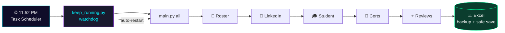

<!-- Created by YOGESHWARAN TL -->
<div align="center">


<br/>


</div>

```text
 ____   _____     _     ____   ____    ___   _   _    __     __ _   _  _____
|  _ \ | ____|   / \   |  _ \ / ___|  / _ \ | \ | |   \ \   / /| | | || ____|
| |_) ||  _|    / _ \  | |_) |\___ \ | | | ||  \| |    \ \ / / | | | ||  _|
|  __/ | |___  / ___ \ |  _ <  ___) || |_| || |\  |     \ V /  | |_| || |___
|_|    |_____|/_/   \_\|_| \_\|____/  \___/ |_| \_|      \_/    \___/ |_____|
      _     _   _  _____   ___   __  __     _     _____  ___   ___   _   _
     / \   | | | ||_   _| / _ \ |  \/  |   / \   |_   _||_ _| / _ \ | \ | |
    / _ \  | | | |  | |  | | | || |\/| |  / _ \    | |   | | | | | ||  \| |
   / ___ \ | |_| |  | |  | |_| || |  | | / ___ \   | |   | | | |_| || |\  |
  /_/   \_\ \___/   |_|   \___/ |_|  |_|/_/   \_\  |_|  |___| \___/ |_| \_|
                                                 >> by YOGESHWARAN TL  v0.1
```

## 🧠 What it does

Everything for the **Pearson VUE exam Excel workbook** in one program. It logs in to Pearson VUE Connect, reads the day's roster, joins it with feedback, LinkedIn, student records and Google reviews, and writes it all to Excel.

| # | Task | Source ➜ Excel |
|:-:|------|----------------|
| 1 | 🎯 **pvue** | Pearson VUE Connect ➜ Site Manager ➜ Roster (name, client, exam, phone) + Feedback Google Sheet |
| 2 | 🔗 **linkedin** | Outlook contact card ➜ LinkedIn URL, with a Google search fallback and strict name/company matching |
| 3 | 🎓 **student** | **Adv Pro** desktop app ➜ search phone ➜ `Our Student` y / n |
| 4 | 🏅 **certs** | LinkedIn "Licenses & certifications" ➜ **y** in each certification column (RHCSA … Anthropic) |
| 7 | ⭐ **reviews** | Google Maps reviews (last 24 h) ➜ `Google Review` = **Y** + remark. **Only real reviews** |
| 5 | ⚡ **all** | 1 ➜ 2 ➜ 3 ➜ 4 ➜ 7 for the same date, plus a catch-up of the last 7 days |



## 🛡️ Built-in safety ("cyber" mode)

- 🔐 **Secure vault.** `lock.bat` encrypts the source and leaves only `.pyc` files, with a 3-try lockout. `unlock.bat` brings the source back.
- 💾 **Backups.** A backup is made before every Excel write, and every save is atomic (temp file + replace).
- 🔁 **Self-healing.** The watchdog restarts the program, resumes from `logs\progress_<date>.json`, and catches up on the last 7 days.
- 🧩 **Extension-aware.** It turns the Pearson auto-login extension off while it works and back on at the end.
- 🧭 **Strict matching.** Fake/placeholder phone numbers are ignored, and LinkedIn matches need the name **and** company/location to agree.
- 🖥️ **Live view** (`show_status.bat`) + 🩺 **Repair tool** (`Repair\Repair.bat`).

## ⚙️ Setup

1. Install **Python 3.11+** and **Google Chrome**.
2. Install the packages:
   ```bat
   pip install -r requirements.txt
   ```
3. Open `config.ini` and fill in your own values:
   | Section | What to set |
   |---|---|
   | `[excel]` | Path to your Pearson VUE Excel workbook |
   | `[chrome]` | `chrome.exe` path, debug port, auto-login extension id |
   | `[pearson]` | Connect URL, username, password, site ID, Chrome shortcut |
   | `[feedback]` | Feedback Google Sheet link + Chrome shortcut |
   | `[linkedin]` | Outlook Chrome shortcut, Google fallback options |
   | `[advpro]` | Path + login of the Adv Pro desktop app |
   | `[certs]` · `[review]` · `[catchup]` | Delays, Google Maps link, catch-up days |
4. Close every Chrome window once, so the program can start Chrome with the control port.

> ⚠️ **Never upload `config.ini`, Excel files, `backups\`, `logs\`, `reports\`, `downloads\` or `chrome_profiles\` to GitHub.** They hold logins and candidate data.

## 🚀 How to use

| Want to… | Do this |
|---|---|
| Open the menu | Double-click **`run.bat`** |
| Run everything for a day | **`run_all.bat`** |
| Only LinkedIn / certs / reviews | `run_linkedin.bat` · `run_certs.bat` · `run_reviews.bat` |
| Watch the nightly run | **`show_status.bat`** |
| Stop the automation | **`stop.bat`** |
| Fix problems | **`Repair\Repair.bat`** |

Command line:

```bat
python main.py                                  :: menu
python main.py all      --date 19-11-2026       :: everything for one day
python main.py pvue     --date 19-11-2026 [--skip-roster] [--skip-feedback]
python main.py linkedin --month 2026-11 --limit 5
python main.py student  --date 19-11-2026
python main.py certs    --month 2026-11
python main.py reviews  --date 19-11-2026
python main.py all      --dry-run               :: test run, nothing is saved
python main.py test                             :: offline Excel test
```

### 🌙 Nightly (automatic)
Task **"PearsonVUE Nightly 1150PM"** runs `run_hidden.vbs` ➜ `run_nightly.bat` ➜ `keep_running.py --nightly` at **11:52 PM**, then every 10 minutes. It waits its turn for Chrome if the Red Hat program is busy. Check `logs\keep_running.txt` in the morning.

## 📁 Files

```text
main.py                  menu + every task
pvue_automation.py       roster reader (original version)
linkedin_from_outlook.py Outlook -> LinkedIn (standalone)
linkedin_certs.py        certifications (--list / --recheck)
google_reviews.py        Google Maps reviews
keep_running.py          watchdog / nightly
live_view.py             live status window
test_excel_dryrun.py     offline Excel test
secure_vault.py          lock / unlock
Repair\                  repair tool
```

<div align="center">

## 👨‍💻 Created by

<a href="https://github.com/yogeshwaran2912"></a>

**Yogeshwaran** · *Robots read the roster so people don't have to* 🤖


</div>
